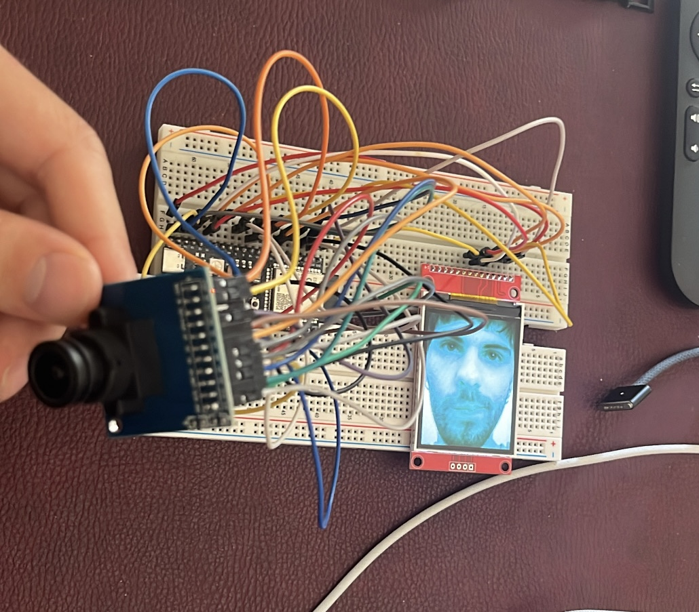

## cwmera

## HARDWARE COMPONENTS

#### ESP32-S3

* **CPU:** Dual-Core Xtensa LX7 a 240 MHz.
* **Flash Memory:** **8 MB**
* **PSRAM (Memoria Extra):** **8 MB**

#### Display: ST7789 IPS LCD

* **Resolution:** **240x320 pixel**.
* **Protocol:** SPI.

#### OV7670 with FIFO (AL422B)

* **Mative Resolution:** VGA (640x480), configured as **QVGA (320x240)** to scale it into the display.
* **Color Format:** **RGB565** (16-bit per pixel, convertito da YUV via software/registri).
* **I2C Address (SCCB):** `0x21` 
* **Integrated FIFO Memory:** Chip AL422B. The ESP32-S3 can capture the photo and read it without losing any frame.

---

### PINOUT

#### Display ST7789 -> ESP32-S3

| Pin ST7789 | Function | Pin ESP32-S3 |
| --- | --- | --- |
| **VCC** / VDD | Power Supply | **3.3V** |
| **GND** | Ground | **GND** |
| **CS** | Chip Select | **GPIO 10** |
| **RESET** / RST | Reset Hardware | **GPIO 9** |
| **DC** / A0 / RS | Data/Command | **GPIO 8** |
| **SDA** / MOSI | SPI Data | **GPIO 11** |
| **SCK** / SCLK | SPI Clock | **GPIO 12** |
| **LED** / BLK | Backillumination | **3.3V** |

#### OV7670 FIFO -> ESP32-S3

| Pin OV7670 | Funciton | Pin ESP32-S3 / Destination |
| --- | --- | --- |
| **3.3V** | Power Supply | **3.3V** |
| **GND** | Ground | **GND** |
| **SIOD** | I2C Data (SDA) | **GPIO 4** |
| **SIOC** | I2C Clock (SCL) | **GPIO 5** |
| **VSY** / VSYNC | Vertical Synch | **GPIO 6** |
| **HREF** | Horizontal Synch | -|
| **PWON** / PWDN | Power Down | **GND** |
| **RST** / RESET | Reset | **3.3V* |
| **OE** | Output Enable FIFO | **GND** |
| **WR** | Write Enable FIFO | **GPIO 15** |
| **WRST** | Write Reset FIFO | **GPIO 16** |
| **RRST** | Read Reset FIFO | **GPIO 17** |
| **RCK** | Read Clock FIFO | **GPIO 18** |
| **STR** | Strobe (Flash) | *Scollegato* |
| **PCK** | Pixel Clock | *Scollegato* |
| **D0** | Data Bit 0 | **GPIO 1** |
| **D1** | Data Bit 1 | **GPIO 2** |
| **D2** | Data Bit 2 | **GPIO 3** |
| **D3** | Data Bit 3 | **GPIO 7** |
| **D4** | Data Bit 4 | **GPIO 13** |
| **D5** | Data Bit 5 | **GPIO 14** |
| **D6** | Data Bit 6 | **GPIO 21** |
| **D7** | Data Bit 7 | **GPIO 47** |

#### Pulsanti di Controllo -> ESP32-S3

| Pulsante | Posizione / Funzione | Pin ESP32-S3 | Collegamento Elettrico |
| --- | --- | --- | --- |
| **Pulsante Camera** | In alto (Scatto / Mirino / Wi-Fi) | **GPIO 38** | Tra GPIO 38 e **GND** (pull-up interno abilitato) |
| **Pulsante Galleria** | Accanto al display (Galleria / Scorri / Elimina) | **GPIO 39** | Tra GPIO 39 e **GND** (pull-up interno abilitato) |

#### Buzzer Passivo (Feedback Sonoro) -> ESP32-S3

| Componente | Pin Buzzer | Pin ESP32-S3 | Collegamento Elettrico |
| --- | --- | --- | --- |
| **Buzzer Passivo** | Positivo / Segnale (`+` o `S`) | **GPIO 41** | Collegato a GPIO 41 |
| | Negativo / Terra (`-`) | **GND** | Collegato a GND |

### Comandi Pulsanti:
* **Pulsante in Alto (Fotocamera):**
  * **Nel Mirino Live:**
    * **Click Singolo:** Scatta istantaneamente la foto e la salva nella memoria flash (`/DCIM/FOTO_xxxx.jpg`).
    * **Pressione Prolungata (> 450ms):** Appare a schermo il timer circolare di **`trasmissione`** (`0% -> 100%`). Se completato al 100%, avvia la modalità **`cwmera wifi`** per scaricare le foto sullo smartphone. Se rilasciato prima, torna al mirino live senza attivare il Wi-Fi.
  * **In Modalità Galleria:**
    * **Click Singolo o Tenuto Premuto:** Al rilascio torna al mirino live della fotocamera, senza ascoltare la trattenuta (nessuna attivazione involontaria del Wi-Fi).

* **Pulsante Accanto al Display (Galleria):**
  * **Nel Mirino Live:**
    * **Click Singolo o Tenuto Premuto:** Al rilascio apre la **galleria** mostrando l'ultima foto scattata, senza ascoltare la trattenuta.
  * **In Modalità Galleria:**
    * **Click Singolo:** Scorre alla foto precedente.
    * **Pressione Prolungata (> 450ms):** Appare a schermo il timer circolare di **`eliminazione`** (`0% -> 100%`). Se completato al 100%, la foto corrente viene cancellata definitivamente. Se rilasciato prima, l'eliminazione viene annullata in sicurezza.

* **In Modalità Wi-Fi (cwmera wifi):**
  * **Click su qualsiasi pulsante:** Spegne il server Wi-Fi e torna al mirino live della fotocamera.

* **Pressione Simultanea (Entrambi i Pulsanti Insieme):**
  * **In qualsiasi modalità:** Disattiva o riattiva istantaneamente tutti i suoni di sistema (muta / smuta).
  * L'impostazione viene **salvata in modo permanente** nella memoria non volatile (NVS).
  * Mostra per 1.5 secondi una schermata bianca con la scritta centrata **"suoni attivati"** o **"suoni disattivati"** prima di tornare alla visualizzazione precedente.

---

### Come Collegare lo Smartphone alla Fotocamera (Galleria Wi-Fi per iOS e Android):
1. Nel mirino della fotocamera, **tieni premuto il pulsante in alto** fino al completamento dell'anello per passare subito alla modalità **`cwmera wifi`**.
2. Sullo smartphone (iPhone o Android):
   * Vai nelle impostazioni **Wi-Fi** e connettiti alla rete **`cwmera`** (nessuna password richiesta).
   * Se si apre la schermata automatica di accesso:
     * Clicca su **`copia`** per copiare l'indirizzo (`http://192.168.4.1/`).
     * Chiudi la schermata (su iPhone tocca **"Fine"** e seleziona **"Usa senza Internet"**; su Android mantieni la connessione Wi-Fi).
   * Apri il tuo browser preferito (Safari, Chrome, Firefox...) e **incolla l'indirizzo** `http://192.168.4.1/`.
   * Vedrai la galleria completa con:
     * Memoria libera disponibile e stima delle foto rimanenti.
     * Icona di download diretto per salvare le foto nel rullino.
     * Icona cestino per eliminare le foto dall'ESP32.
     * Icona di aggiornamento firmware in alto per verificare le nuove versioni su GitHub.
3. Premi 1 volta uno dei pulsanti fisici sulla fotocamera per spegnere il Wi-Fi e tornare istantaneamente al mirino live!

---

### Aggiornamento Firmware Online (OTA via GitHub Releases)
`cwmera` supporta l'aggiornamento del firmware via Wi-Fi direttamente dai rilasci ufficiali di GitHub senza bisogno di cavi USB:
1. Connettiti alla rete **`cwmera`** e apri la pagina web (`http://192.168.4.1/`).
2. Clicca sull'**icona di aggiornamento** nella barra superiore accanto al selettore matrice/elenco.
3. Inserisci il nome (SSID) e la password del tuo Wi-Fi di casa (puoi spuntare *"memorizza questa rete"* per non ridigitarla in futuro) e premi **`verifica`**.
4. Guarda il **display ST7789** della fotocamera:
   * Si connetterà al Wi-Fi.
   * Verificherà se è presente una nuova release su GitHub.
   * Se presente, scaricherà il nuovo firmware mostrando la barra di avanzamento e si riavvierà automaticamente.

> [!NOTE]
> **Requisito Schema Partizioni**: in Arduino IDE seleziona uno schema che supporti l'OTA (ad esempio `8MB with spiffs (3MB APP/1.5MB SPIFFS)`).